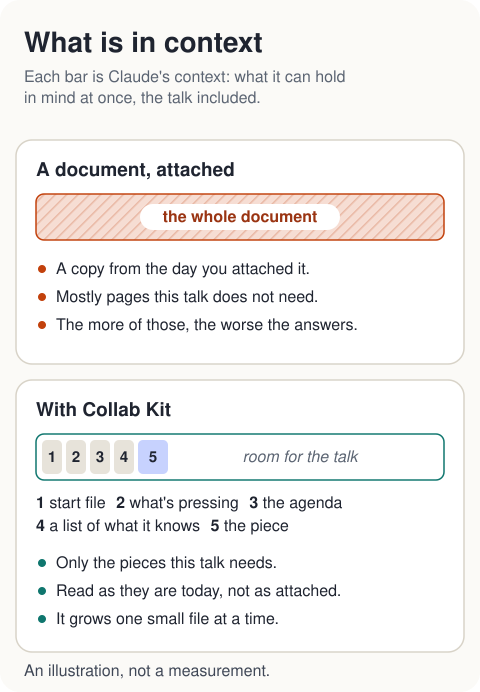
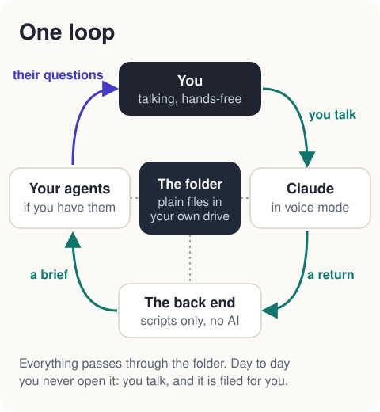

<p align="center">
  
</p>

<h1 align="center">Collab Kit</h1>

<p align="center">
  <a href="https://github.com/sirfifer/collab-kit/actions/workflows/ci.yml"></a>
</p>

**Collab Kit is not an app. You talk to Claude in the Claude app on your phone, using the voice mode
that is already built into it. Collab Kit is a folder of plain files, and a few scripts, that give
that voice mode the one thing it lacks: a working knowledge of your project.**

With it you can have a long, fully informed working conversation about a complex project,
hands-free: an hour on a hard problem, where every answer depends on what the project actually says.
It is a way of collaborating with an AI on serious work: you guide it, and you judge what comes of it.

To see what it takes and set it up: [what you need](#what-you-need), then [try it](#try-it).

## The problem it solves

**A voice conversation does not happen on your phone.** When you use Claude at your computer, it
works where your work is: it can read the repository, open the documents, see what changed today.
Voice mode is different. You are talking to a service in the cloud, and it can see nothing on your
phone or your computer. It knows some of your earlier chats, and whatever you hand it.

The one thing it can reach is another cloud service that you have connected to Claude, such as
Google Drive. So that is where Collab Kit puts what voice mode needs.

**What it puts there is not your project.** A project's own files are made for other purposes:
code, long documents, data, drafts. Copying them to the cloud would not help. What goes there is a
knowledge structure: a representation of the project built for one job, which is to let Claude load
exactly what a conversation needs. It is organised, split into small pieces, and indexed. In a
complex project it is a fraction of what the project holds, and it is kept in step with the project
as the work moves.

**That shape matters, because of context.** Context is what an AI can hold in mind at once: everything
it has been given to read, plus the conversation itself. It is limited. Hand over a whole
architecture document, or a full draft, and most of the context goes to pages this conversation does
not need. That is worse than wasted room: the more there is in context that has nothing to do with
the question, the worse the answers get. A deep conversation needs the right pieces in context, and
little else.

<p align="center">
  
</p>

What goes into the knowledge structure is whatever the work needs, and it changes as the work does.
Some of it is written in conversations like the one below: what was decided and why, and where each
part of the work stands. Some is built from documents you choose, each split into sections. An
index lists all of it. Claude reads that list, then opens the two or three pieces the conversation
has turned to. When a talk finds the structure thin on some topic, you say so, and filling that gap
becomes a task. And what you work out is written back, so the next conversation starts where this
one ended.

## What a session is like

The person and the project here are invented. The kind of work is the kind this was built for.

Maya is in the fourth year of a doctorate. Her dissertation asks why some community land trusts last
for decades and others fold: fourteen cases, three years of interviews, and a third chapter she has
rewritten twice. She is walking a trail above town, phone in her jacket.

> **Maya:** Where did I leave chapter three?
>
> **Claude:** Half rewritten. Last Thursday you decided the chapter should argue that the trusts
> which lasted were the ones that gave residents a real vote, and you said you had redrafted the
> first two sections that way. Section three still makes the older argument, that it came down to
> cheap land. And one thing is waiting on you: Professor Okafor's comment that the two explanations
> may not be separable. Your committee meets on the twelfth.
>
> **Maya:** That comment is what's bothering me. I think she's right that I can't separate them with
> fourteen cases. But I don't want to retreat to "it's complicated." Which cases actually tell the
> two apart?
>
> **Claude:** By your comparison table, three. In the other eleven the two go together: cheap land
> and a resident vote, or neither. Harbor Street had expensive land and a resident vote, and it
> lasted. Eastgate and Mill Row had cheap land and no vote, and both folded within ten years.
>
> **Maya:** Harbor Street. The director told me the vote was the only reason they didn't sell the
> land in the budget fight. But that's one interview, and he had every reason to say so. What else
> do I have from that year?
>
> **Claude:** Your summary of that case lists three sources: his interview, two newspaper pieces
> about the budget fight, and the board minutes for that year, which you copied in the archive in
> March. I have the summary, not the minutes themselves.
>
> **Maya:** The minutes. I never used them. If they show residents outvoting the city's appointees
> on the sale, that's not his story, that's the record. Okay. So I don't claim the vote matters more
> than land prices in general. I claim that where the two come apart, the record shows what the vote
> did, and what happened without one.
>
> **Claude:** That is a narrower claim, and it stands or falls on what the minutes say. It also
> changes what section three is for. Do you still want the land price material in it?
>
> **Maya:** Keep it, but as the rival explanation I take seriously, not as my argument. And I should
> tell Okafor before the twelfth, not at it.
>
> **Claude:** I'll write that down: the narrower claim and your reasoning, with the condition that
> the minutes bear it out; section three recast around the three cases; a task to go through the
> Harbor Street minutes; and a note to write to Professor Okafor this week. Anything to change?
>
> **Maya:** Add that I need to find out whether Mill Row kept minutes at all.

She walked for another half hour and never took the phone out.

What to notice:

- **Claude knew where she was,** because it had just read it. What she decided last week is in the
  knowledge structure, and the comment waiting on her is on the agenda, the list of what needs her.
- **It worked from the knowledge structure, not from her project.** It opened two pieces: the
  comparison across her cases, and her summary of one of them. It never had her interview
  transcripts, the copies from the archive, or the chapter drafts, and it said so when that
  mattered. What is in the structure is what the work has needed so far.
- **She was the filter.** Claude kept track of where things stood and handed back what the
  structure held on the question she asked. In this talk the idea was hers as well. In another,
  more of it might come from Claude. Either way, nothing was settled until she had judged it.
- **Nothing was lost.** By the time she was home, the decision and her reasoning were in the
  knowledge structure and the new tasks were on the agenda. The next conversation starts from them.

What this took: Maya's project is in a git repository, and she chose which of its documents feed
the knowledge structure: her case summaries, the comparison, her chapter outlines. The kit splits
those into sections and indexes them, and a Mac at home keeps that current as she works. The rest
of her project was never part of it. That is the fullest setup, and the one with the most steps
([docs/setup.md](docs/setup.md)). A project whose knowledge is a handful of notes needs only the
folder.

## Who it is for

People doing serious, involved work who want to think it through out loud, away from the desk, with
an AI that knows the work: a dissertation, the architecture of a system, a book, a product, the
planning of something with many moving parts. Quick questions and passing notes work too, alongside,
but they are not why this exists, and they need none of it.

It is a way of collaborating, and that covers a wide range. Sometimes the two of you reach something
neither would have alone. Sometimes Claude is closer to a research assistant: with the knowledge
structure in reach, it can tell you what you already decided, what is covered and what is missing,
read a passage back, or put it another way. Sometimes much of the substance
comes from Claude, and your part is to steer. Across all of it you are the filter: you guide the
work and you judge what comes back. What it is not is an agent that goes off and does your work with
you out of the loop ([VISION.md](VISION.md)).

## What you need

- **The Claude app, with voice mode and the Google Drive connector** (the switch in the app that
  lets Claude read and write your Drive). Using connectors in voice mode needs a paid Claude plan,
  at the time of writing. Google Drive is the only storage that works today.
- **A computer, once,** to create the folder: Python 3.11 or newer, and Google Drive for desktop, so
  the folder can be written as ordinary files. After that a phone is enough.
- **For a knowledge structure built from a project's documents,** as in the session above: the
  project in a git repository, the documents you choose for it as Markdown files, and a machine that
  stays on. You list those documents once; the kit splits them into sections at their headings and
  rebuilds the index when they change. Setting that up takes several steps by hand today
  ([docs/setup.md](docs/setup.md)).
- **Optional:** [Claude Code](https://claude.com/claude-code) in the project's repository, if AI
  agents also work on it (below).

Collab Kit is an independent project. It is not made or endorsed by Anthropic.

## How it works

<p align="center">
  
</p>

1. **You talk,** to Claude, in its own app. One line in the app's preferences points every
   conversation at the folder. That is the whole setup on a phone.
2. **Claude opens only what the talk needs.** First what is pressing across all your projects, then
   one project's agenda, then the pieces of its knowledge structure that the talk is about.
3. **It writes back a return**: a small text file that says what was decided and what is new.
4. **The back end files it,** within minutes: it updates the agenda and the knowledge structure. The
   back end is scripts on a machine that stays on, and nothing else: there is no AI in it. With no
   back end, the conversation files its own returns by the same rules, so the folder alone is enough
   to start.

A return dictated on a phone was on the agenda about three minutes later (measured on the author's
setup, 2026-11-20). The whole loop, step by step: [docs/how-it-works.md](docs/how-it-works.md).

### When AI agents work on the project too

Many projects are also worked on by AI coding agents, in a git repository. With the kit installed
there, the same folder joins the two: each agent session opens with a brief of what is waiting (your
questions, what is due, recent status), and the agent's own progress and questions go back onto your
agenda, where your next conversation finds them. What it learns that should last goes into the
knowledge structure. Today you start each agent session yourself. Any other system you run can do
the same: whatever can run the kit's command can put an item on your agenda.

A brief looks like this. It is the start of a real one, from this project's own example:

```
## Collab Kit: project collab-kit
Agenda: 9 open, 0 overdue or due within a week, 1 critical, 1 in progress.
Critical (importance 1):
  W-021 [task, importance 1, in progress] Full check: the kit's own install, ...
Most important open:
  W-008 [question, importance 2] ChatGPT and Gemini
  W-015 [task, importance 2] Approved pushes of project work to GitHub
```

## Where it stands

It is young. One person, the author, has worked this way daily since 2026-11-14, across four
projects, with the back end on an always-on Mac since 2026-11-18. The latest release is 0.5.3; this
page describes the main branch, and [CHANGELOG.md](CHANGELOG.md) says what is not yet in a release.

**Works today**

- Long working conversations in the Claude app's voice mode, and the same in typed chat, with Google
  Drive.
- A knowledge structure built from the documents you choose, split into sections behind an index,
  for a project in a git repository with a back end. This is the oldest part of the kit, and its
  setup is the least polished: several steps by hand
  ([docs/setup.md](docs/setup.md); a sample:
  [examples/the-lighthouse](examples/the-lighthouse/README.md)).
- Several projects in one folder: "switch to the other project" in the middle of a talk.
- A back end on macOS that checks for new returns every minute.
- Starting a new project by voice, in one step, even from a talk that began with no project in
  mind: you say "make this a project".
- Hearing what finished, at the start of a talk and at each change of project.
- A notification on your phone when something critical appears. If you want, also when an agent
  reports.
- With agents: a brief at the start of every session. An agent that is stuck can send you its
  question as critical, and gets your spoken answer.
- A new project getting a git repository of its own, private on GitHub, if you turn that on for your
  back end's machine (tested against a stand-in for GitHub, not yet with a real account).
- A notification from outside when the back end stops, if you set one up (written and tested; the
  author has not turned it on yet).

**Not yet**

- ChatGPT: a hands-free set-up is worked out from OpenAI's own settings and **not yet verified**.
  Running its test is one of the easiest ways to help: [other assistants](docs/other-assistants.md).
  Gemini cannot yet list a folder or write a plain file by voice; Mistral's app does not yet speak
  back.
- Storage other than Google Drive.
- Sharing a project with other people.
- Starting an agent's session from your phone, for a task you marked (designed, not built).
- A plot, a page, or a video from an agent reaching your phone.
- Being told in the middle of a talk, unasked, that something just finished.
- A back end on Linux or Windows: the schedules are written, and have not run on a real machine.
- A back end with no machine of your own: one for GitHub Actions is written, and has not run against
  a live Drive.

## Where your data goes

- **Your Google Drive folder** holds everything Collab Kit writes: the knowledge structure and the
  agenda, not your project's own files. Whoever can read the folder can read all of it.
- **The folder is also a way in,** to your back end and to any agents you run, so keep it private
  to you. It is shared between your phone and your back end, not with other people. The scripts
  apply what is written there as data and never follow it as instructions, and agents see it marked
  as data. [SECURITY.md](SECURITY.md) says what that does and does not protect.
- **Claude.** The conversation is with Claude, in Anthropic's app, on your account. What Claude
  reads from the folder goes to Anthropic, as in any use of Claude. Nothing goes to the author of
  Collab Kit.
- **Git.** A project that lives in a repository commits its agenda and knowledge structure there.
  The back end never sends anything to a public repository unless the project allows it, and a
  repository it creates for a new project is always private.

## Try it

<p align="center">
  
</p>

**The easy way:** point an AI coding agent at this repository and ask it to set Collab Kit up for
you. [docs/for-agents.md](docs/for-agents.md) is written for exactly that, step by step. (If you are
that agent: start there.)

**By hand, the folder alone.** Clone this repository (the Code button on its GitHub page gives the
address). Then create the folder inside your Google Drive, as Google Drive for desktop shows it on
your computer. On a Mac:

```bash
python3 install.py top "$HOME/Library/CloudStorage/GoogleDrive-you@example.com/My Drive/Collab Kit" --human "Sam"
```

In the Claude app, turn on the Google Drive connector. Then, in the app's settings, add this to your
personal preferences (the text Claude reads at the start of every conversation):

> When I talk about my work or a project, or say 'make this a project' or 'save this to Collab Kit',
> first open 00-START-HERE.md in my Google Drive folder 'Collab Kit' (list the folder; never search
> all of Drive) and follow it.

That is all a phone needs. A new folder has nothing in it yet, so start by talking something through
in voice mode, then say "make this a project". The next time, ask where you left it.

**Then, when you want them:** a back end, the kit in a project's repository, and a knowledge
structure built from a project's documents. All three are in [docs/setup.md](docs/setup.md).

## What is in the folder

```
Collab Kit/
  00-START-HERE.md  Claude starts here
  agenda/           what needs you
  knowledge/        knowledge structure
  _returns/         inbox for changes
  WIP/              notes mid-talk
  projects/
    dissertation/
      collab-kit/   same, per project
```

The top level is for what belongs to no single project. Every project is laid out the same way, so
one set of rules covers all of it. Every file, who writes it and who reads it, is in
[docs/folder-structure.md](docs/folder-structure.md). There is one real project to browse, this one
as it stood on 2026-11-19, with private details removed:
[examples/the-kit-itself](examples/the-kit-itself/README.md).

### A return: the one way anything changes

Nobody edits the agenda or the knowledge structure directly, person or agent. Every change is a
return: a small text file dropped in an inbox, applied whole or not at all, and undoable. A
conversation dictates it; an agent files it with one command; the same rules apply to both. This is
what Claude wrote at the end of Maya's walk, in part:

```
Project: dissertation
From: Maya
Type: decision
Topic: chapter three argues from the three cases
Changes v1:
settle W-012 "chapter three" outcome="a narrower claim: what the vote did where the two explanations come apart, if the minutes bear it out"
new-item kind=task importance=2 title="Go back through the Harbor Street board minutes"
End.
```

`W-012` is an agenda item's number. The quoted words after it repeat part of the item's title, so a
misheard number cannot change the wrong item.

## Find your way around

- [VISION.md](VISION.md): why this exists, and the test it is held to. Start here if you want to
  know what it is for.
- [How it works](docs/how-it-works.md): the whole loop, one return's life, how fast.
- [The folder and the method](docs/folder-structure.md): every folder and file, and why it is laid
  out this way.
- [Setting up by hand](docs/setup.md): a back end, a project's repository.
- [For AI agents](docs/for-agents.md): install, upgrade, check, repair, step by step.
- [Other assistants](docs/other-assistants.md): ChatGPT, Gemini and Mistral, what each can do now, and
  the test that would prove ChatGPT works.
- [DESIGN-0.5.md](DESIGN-0.5.md): every decision, and what is planned and not built.
- [SECURITY.md](SECURITY.md): the threat model, and how to report a vulnerability.
- [CHANGELOG.md](CHANGELOG.md): what changed in each release.

More: [notifications on your phone](docs/notifications.md),
[the end-to-end test](docs/capability-walkthrough.md) (one invented user's whole day by voice), how
the back end reaches [Google Drive](docs/rclone-intake.md) and [GitHub](docs/gh-intake.md),
[prior art](docs/prior-art-2026-11-14.md), and how a knowledge structure is built from documents
([DESIGN.md](DESIGN.md)).

## Working on the kit

Start with [CONTRIBUTING.md](CONTRIBUTING.md). Found a problem, or something unclear? Open an issue.
A vulnerability is reported privately: [SECURITY.md](SECURITY.md).

License: [MIT](LICENSE).
