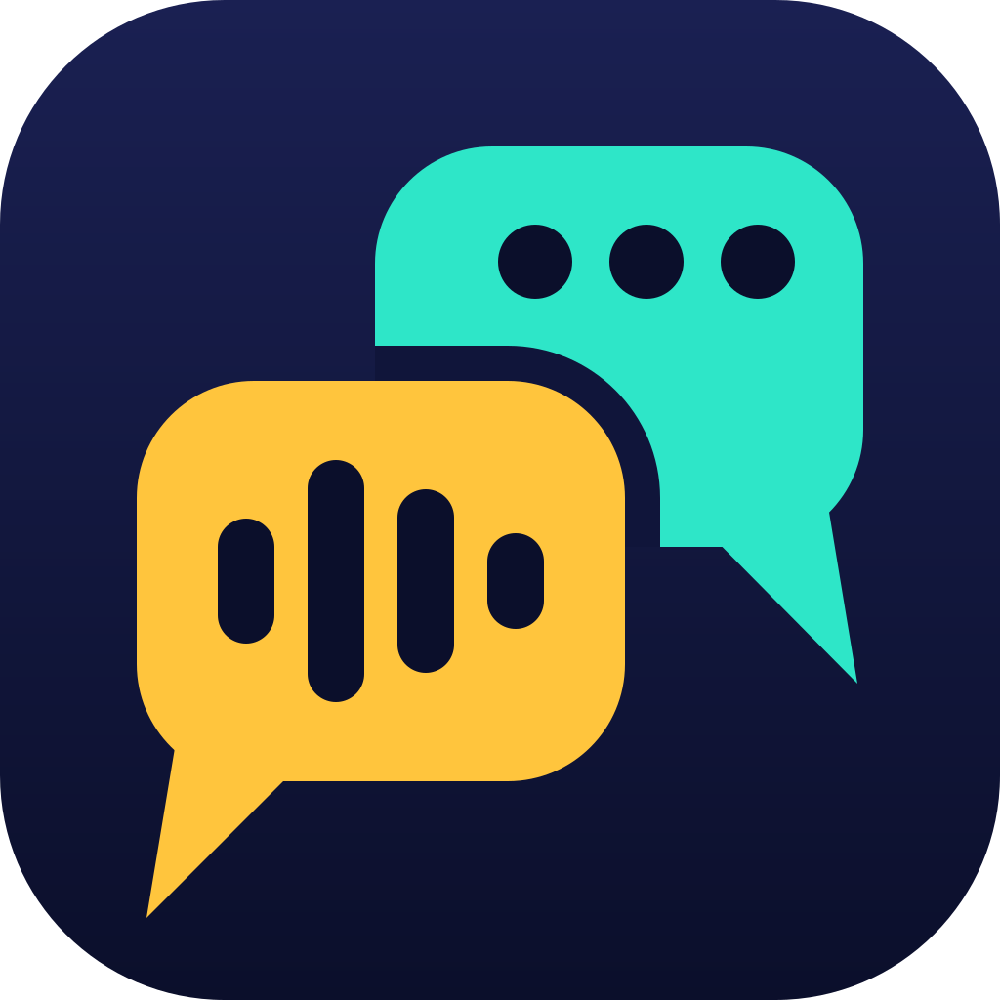
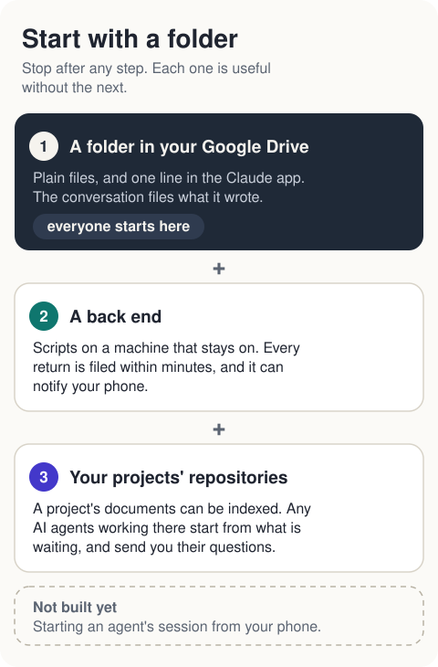

<p align="center">
  
</p>

<h1 align="center">Collab Kit</h1>

**Collab Kit makes it possible to have long, fully informed working sessions with Claude about a
complex project, hands-free and entirely by voice.**

On its own, voice mode cannot see your project. You can attach documents, but that takes your hands,
gives it a snapshot that goes stale, and one large document can fill the conversation. Collab Kit
keeps what each project knows, and what needs you, as small named files in a folder in your own
Google Drive. Claude opens only the ones the talk turns to, so it works from what the project says
today.

What you work out is written back to the same folder: decisions are recorded, and new questions go
on a list of what needs you, the agenda. AI agents working in the project's repository start each
session from that agenda, and send their own questions back to you. It is all plain files and a few
scripts: no service to sign up for, and no database.

It is for people who run real projects, often with AI coding agents doing the work, and who want to
think and decide away from the desk.

## What a session is like

You are out walking, phone in your pocket. Nothing was prepared and nothing was attached. (The
project here is invented: an app for planning a garden.)

> **You:** What's pressing?
>
> **Claude:** Two things. In the garden planner, the decision on which beds get the tomatoes is due
> Friday. And the agent working on the newsletter is blocked on a question about the archive. Five
> more after that, none urgent.
>
> **You:** Let's get into the garden planner.
>
> **Claude:** The agent finished the shade model last week, and the north beds come out under four
> hours of sun. There is still an open question from October about the drip line. Where do you want
> to start?

Forty minutes later the tomatoes have a home, the reasoning is written down, and two new questions
are on the agenda, one of them addressed to the agent. You say "switch to the newsletter" and keep
going. You never touched the phone.

By the time you are home it is all filed. The next agent session in the garden planner's repository
opens with what is waiting for it, and your question is on the list. When that agent meets something
only you can answer, it puts the question on your agenda, and your next walk starts with it.

## What you need

- **Claude, with voice mode and the Google Drive connector** (the switch in the Claude app that lets
  it read and write your Drive). Using connectors in voice mode needs a paid Claude plan, at the
  time of writing. Google Drive is the only storage that works today.
- **A computer, once,** to create the folder: Python 3.11 or newer, and Google Drive for desktop, so
  the folder can be written as ordinary files. After that a phone is enough.
- **Optional:** a machine that stays on, to file what you said within minutes (the back end); and
  [Claude Code](https://claude.com/claude-code) in your projects' repositories, so the agents there
  take part.

Collab Kit is an independent project. It is not made or endorsed by Anthropic.

## How it works

<p align="center">
  
</p>

1. **You talk.** One line in the Claude app's preferences points every conversation at the folder.
   That is the whole setup on a phone.
2. **Claude opens only what the talk needs.** First what is pressing across all your projects, then
   one project's agenda, and the one file of what it knows that the talk is about.
3. **It writes back a return**: a small text file that says what was decided and what is new.
4. **The back end files it,** within minutes: it updates the agenda and the project's knowledge. It
   is scripts and nothing else. With no back end, the conversation files its own returns by the same
   rules, so the folder alone is enough to start.
5. **Agents start from it.** Each agent session in a project's repository opens with a brief (what
   is waiting, what is due, recent status), and its own progress and questions come back the same
   way. Today you start each agent session yourself.

A brief looks like this. It is the start of a real one, from this project's own example:

```
## Collab Kit: project collab-kit
Agenda: 9 open, 0 overdue or due within a week, 1 critical, 1 in progress.
Critical (importance 1):
  W-021 [task, importance 1, in progress] Full check: the kit's own install, ...
Most important open:
  W-008 [question, importance 2] ChatGPT and Gemini
  W-015 [task, importance 2] Approved pushes of project work to GitHub
```

A return dictated on a phone was on the agenda about three minutes later (measured on the author's
setup, 2026-11-20). The whole loop, step by step: [docs/how-it-works.md](docs/how-it-works.md).

## Why voice mode cannot do this alone

Plenty of things need no Collab Kit: a quick question, a brainstorm from nothing, dictating a note.
The difference shows when the talk is long, the project is involved, and the answers depend on what
the project says today. First, there has to be room for the talk:

<p align="center">
  
</p>

A project with many documents can go a step further: the kit splits them into sections behind an
index, so the talk fetches one section of one document. That needs the project to live in a git
repository and a back end on a machine ([DESIGN.md](DESIGN.md); a sample:
[examples/the-lighthouse](examples/the-lighthouse/README.md)).

Then there is what happens around the talk:

- **What you worked out.** In voice mode alone, it stays in the chat. With Collab Kit, decisions are
  recorded, new items join the agenda, and the project's knowledge is updated.
- **Several projects.** Alone, a chat for each, set up by hand. With Collab Kit, you say "switch to
  the newsletter".
- **The agents doing the work.** Alone, they know nothing of what you said. With Collab Kit, your
  questions and tasks are waiting for them, and theirs come back to you.

## Where it stands

It is young. One person, the author, has worked this way daily since 2026-11-14, across four
projects, with the back end on an always-on Mac since 2026-11-18. The latest release is 0.5.3; this
page describes the main branch, and [CHANGELOG.md](CHANGELOG.md) says what is not yet in a release.

**Works today**

- Claude by voice, in chat, and in Claude Code, with Google Drive.
- A back end on macOS that checks for new returns every minute.
- Projects in their own git repositories, or entirely in the folder.
- Starting a new project by voice, in one step, even from a brainstorm that began with no project
  in mind: you say "make this a project".
- A new project getting a git repository of its own, private on GitHub, if you turn that on for your
  back end's machine (tested against a stand-in for GitHub, not yet with a real account).
- A notification on your phone when something critical appears. If you want, also when an agent
  reports.
- Hearing what finished, at the start of a talk and at each change of project.
- An agent that cannot go on sending you its question as critical, and getting your spoken answer.
- A notification from outside when the back end stops, if you set one up (written and tested; the
  author has not turned it on yet).

**Not yet**

- ChatGPT and Gemini (research in progress), and storage other than Google Drive.
- Sharing a project with other people.
- The back end starting agent work by itself (designed, not built).
- A plot, a page, or a video from an agent reaching your phone.
- Being told in the middle of a talk, unasked, that something just finished.
- A back end on Linux or Windows: the schedules are written, and have not run on a real machine.
- A back end with no machine of your own: one for GitHub Actions is written, and has not run against
  a live Drive.

## Where your data goes

- **Your Google Drive folder** holds everything Collab Kit writes. Whoever can read the folder can
  read all of it. Whoever can write to it can file returns; the scripts apply those as data and
  never follow them as instructions ([SECURITY.md](SECURITY.md)).
- **Git.** A project that lives in a repository commits its agenda and knowledge there. The back end
  never sends anything to a public repository unless the project allows it, and a repository it
  creates for a new project is always private.
- **Claude.** Conversations and agents send what they read to Claude, as any use of Claude does.
  Nothing goes to the author of Collab Kit.

## Try it

<p align="center">
  
</p>

**The easy way:** point an AI coding agent at this repository and ask it to set Collab Kit up for
you. [docs/for-agents.md](docs/for-agents.md) is written for exactly that, step by step. (If you are
that agent: start there.)

**By hand, the folder alone.** Clone this repository (the Code button on its GitHub page gives the
address). Then create the folder inside your Google Drive, as Google Drive for desktop shows it on
your computer. On a Mac:

```bash
python3 install.py top "$HOME/Library/CloudStorage/GoogleDrive-you@example.com/My Drive/Collab Kit" --human "Sam"
```

In the Claude app, turn on the Google Drive connector. Then, in the app's settings, add this to your
personal preferences (the text Claude reads at the start of every conversation):

> When I talk about my work or a project, or say 'make this a project' or 'save this to Collab Kit',
> first open 00-START-HERE.md in my Google Drive folder 'Collab Kit' (list the folder; never search
> all of Drive) and follow it.

That is all a phone needs. A new folder has nothing in it yet, so start by talking something through,
then say "make this a project". The next time, ask what's pressing.

**Then, when you want them:** a back end, and the kit in a project's repository. Both are in
[docs/setup.md](docs/setup.md).

## What is in the folder

```
Collab Kit/
  00-START-HERE.md  Claude starts here
  agenda/           what needs you
  knowledge/        what is known
  _returns/         inbox for changes
  WIP/              notes mid-talk
  projects/
    garden-planner/
      collab-kit/   same, per project
```

The top level is for what belongs to no single project. Every project is laid out the same way, so
one set of rules covers all of it. Every file, who writes it and who reads it, is in
[docs/folder-structure.md](docs/folder-structure.md). There is one real project to browse, this one
as it stood on 2026-11-19, with private details removed:
[examples/the-kit-itself](examples/the-kit-itself/README.md).

### A return: the one way anything changes

Nobody edits the agenda or the knowledge directly, person or agent. Every change is a return: a
small text file dropped in an inbox, applied whole or not at all, and undoable. A conversation
dictates it; an agent files it with one command; the same rules apply to both.

```
Project: garden-planner
From: Sam
Type: decision
Topic: tomatoes go in the south beds
Changes v1:
settle W-007 "tomato" outcome="south beds; the north is too shady"
new-item kind=task importance=2 title="Order the drip line"
End.
```

`W-007` is an agenda item's number. The quoted word after it repeats part of the item's title, so a
misheard number cannot change the wrong item.

## Find your way around

- [How it works](docs/how-it-works.md): the whole loop, one return's life, how fast.
- [The folder and the method](docs/folder-structure.md): every folder and file, and why it is laid
  out this way.
- [Setting up by hand](docs/setup.md): a back end, a project's repository.
- [For AI agents](docs/for-agents.md): install, upgrade, check, repair, step by step.
- [VISION.md](VISION.md): why this exists, and the rules it is held to.
- [DESIGN-0.5.md](DESIGN-0.5.md): every decision, and what is planned and not built.
- [SECURITY.md](SECURITY.md): the threat model, and how to report a vulnerability.
- [CHANGELOG.md](CHANGELOG.md): what changed in each release.

More: [notifications on your phone](docs/notifications.md),
[the end-to-end test](docs/capability-walkthrough.md) (one invented user's whole day by voice), how
the back end reaches [Google Drive](docs/rclone-intake.md) and [GitHub](docs/gh-intake.md),
[prior art](docs/prior-art-2026-11-14.md), and the knowledge build for projects with many documents
([DESIGN.md](DESIGN.md)).

## Working on the kit

Start with [CONTRIBUTING.md](CONTRIBUTING.md). Found a problem, or something unclear? Open an issue.
A vulnerability is reported privately: [SECURITY.md](SECURITY.md).

License: [MIT](LICENSE).
