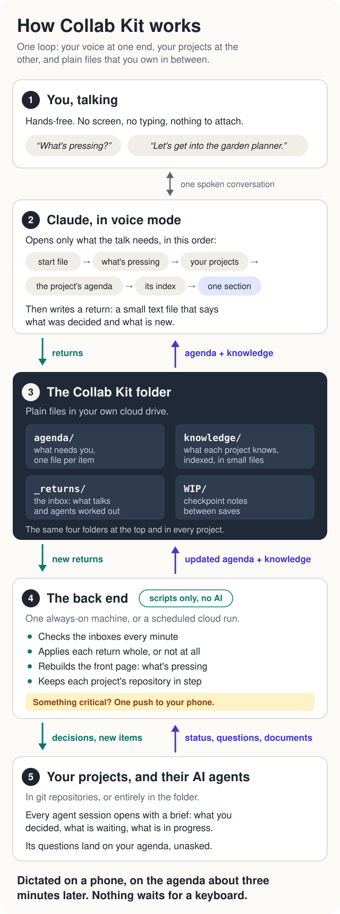
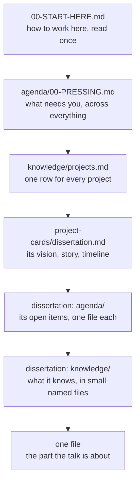

# How Collab Kit works

The [README](../README.md) says what Collab Kit is for. Collab Kit is not an app: the conversation
is with Claude, in the Claude app, in the voice mode built into it (or in typed chat). This page
follows one working session all the way round the loop: what is read, what is written, who does each step, and how long it takes. The
layout of the folder has its own page: [the folder and the method](folder-structure.md). Every
statement here comes from the design record, [DESIGN-0.5.md](../DESIGN-0.5.md); section numbers in
brackets point into it.

<p align="center">
  
</p>

## The five parts

| Part | What it is | What it does | What it never does |
|---|---|---|---|
| **You** | A person with a phone | Talk: ask, decide, change your mind | Attach files, type commands, sit at a desk |
| **The conversation** | Claude in voice mode or chat, with the Google Drive connector | Reads the folder, thinks with you, writes returns | Edit an agenda or knowledge file directly once a back end runs |
| **The Collab Kit folder** | Plain files in your cloud drive | Holds the agenda, the knowledge, the inbox of returns, work in progress | Depend on any app, or on any assistant's memory |
| **The back end** | Scripts on a schedule: one machine, or a cloud run | Applies returns, rebuilds the agenda's front page, keeps repositories in step, reports its health | Run an AI, interpret, decide, or delete |
| **Agents** | AI coding agents (Claude Code) in a project's repository | Start from a brief, do the work, record status, send questions to your agenda | Edit the agenda by hand, or invent an item number |

## One session, step by step

<p align="center">
  
</p>

### 1. The conversation finds its way in

The only setup on a phone is one line in the Claude app's preferences: when you talk about your work,
or say "make this a project" or "save this to Collab Kit", open `00-START-HERE.md` in the Drive
folder `Collab Kit` and follow it. That file says how to work in the folder. It holds no news and no
state, so it almost never changes [19]. The two phrases are for a talk that began as plain
brainstorming, with no project in mind: saying one brings the folder in, and the whole brainstorm
goes into one return [25].

### 2. It hears what matters first

Right after the start file, the conversation opens the agenda's front page, `agenda/00-PRESSING.md`.
The back end writes it from every agenda in the folder: its own health, anything it could not file,
what is overdue or due soon, what is critical, what is in progress [10, 19], and what happened in the
last two days: what agents reported, what was settled, which returns are still waiting [24].
Anything overdue, due within a week, or critical is raised in a sentence or two before anything
else, without being asked; then one sentence on what finished. The conversation reads the page
again each time the talk moves to another project, and says what is new since it last looked.

### 3. It loads only what the talk needs

This is the part that makes long, informed sessions possible. Nothing is loaded in bulk. The
conversation goes down one level at a time, and stops as soon as it has what the talk is about.



Three facts about voice mode shaped this [6, 17, DESIGN.md]:

- **Voice mode can only open whole files, by name, by listing a folder.** So everything is a small file
  with a unique name: one agenda item per file, one section of a document per file.
- **Context is limited, and what is in it matters.** A project's documents, loaded whole, would put
  mostly unneeded pages in context, and the answers get worse for it. Small files with telling names
  let the conversation fetch one piece; for a project with many documents,
  an index names every concept, answer, and section.
- **One spoken reply can make only about seven tool calls.** So the way in is short (about seven
  calls with a back end, one fewer without), and large saves are split across replies without asking.

The index is an extra, for a project with many documents: the knowledge build splits the documents
listed for it into those sections and writes the index ([DESIGN.md](../DESIGN.md);
sample: [examples/the-lighthouse](../examples/the-lighthouse/README.md)). It works for a project whose
home is its repository, is installed there separately ([setup.md](setup.md) has the steps), and is run
by a machine back end on every pass [8]. Every other project keeps its knowledge as a few plain files,
which a conversation lists and opens by name.

Switching projects is the same walk from the catalog down. That is why "switch to the other project"
works mid-conversation: every project is shaped the same way.

### 4. You work

While you talk, the conversation keeps short checkpoint notes in `WIP/`, one tool call each. If the
call drops, the next conversation finds the leftover notes and offers to finish the save [17].

### 5. It saves: a return

At a natural point (something settled, a change of subject, you say "save", always before wrapping
up) the conversation writes what was worked out as a **return**: one small text file in the inbox of
the project it is about.

```
Project: dissertation
From: Maya
Type: decision
Topic: chapter three argues from the three cases
Changes v1:
settle W-012 "chapter three" outcome="a narrower claim: what the vote did where the two explanations come apart, if the minutes bear it out"
question "Did Mill Row keep board minutes at all?" importance=2
status "Chapter three recast around the three cases; the minutes are still to check."
End.
```

The grammar is small and versioned [8]: new items, `set`, `log`, `settle`, `snooze`, `withdraw`,
`reopen`, `status`, `knowledge` (a whole file), `project`, `new-project`, `push-request`, `undo`.
A change to an existing item repeats part of its title in quotes, so a misheard number cannot touch
the wrong item.

**Starting something new** is one return too [11, 25]. In the top-level inbox, `new-project` carries
the name you agreed, the idea as a short title, what it is about, what you call it, and, in a block
under it, everything the talk worked out:

````
Project: top
From: Maya
Type: new-project
Topic: the field season becomes a project

Changes v1:
new-project name=field-season "Plan the summer field season" about="Six weeks in three city archives" spoken="the field season"
```
Three archives, two weeks each. Harbor Street first: the board minutes for every year, not one.
```
End.
````

The back end creates the project's folder, with that text as its first agenda item, and says so on
the front page. Where its machine is set to (`[new_projects]` in `backend.toml`, off by default), it
also makes the project a git repository with the kit installed and, on GitHub, a private one with the
first commit pushed; the catalog then says where the project lives. If that cannot be done, the
folder project is still ready, a critical item says why, and the back end tries again on every full
pass. The kit never creates a public repository.

### 6. The back end files it

The back end is a scheduled job that runs the kit's scripts [9, 20, 22]:

1. **Every minute** it asks one cheap question: has a return settled in any inbox? Then it writes
   the time of that check to a small file, `agenda/00-HEARTBEAT.md` [24].
2. If so, it makes **a full pass**: it reads the folder in one listing, applies each waiting return,
   writes each return's ledger, rebuilds the front page, mirrors repository-homed projects, and
   writes its own health.
3. **A return is applied whole or not at all, and at most once.** The ledger holds the exact before
   and after of every file it changed, so a return can be undone as long as nothing has changed those
   files since.
4. What it cannot apply is set aside, never dropped, and raised on the agenda as a critical item.
5. The first time a critical item appears, it can send one push to your phone, and, if you turn
   that on, one for each status line an agent reports ([notifications](notifications.md)).

### 7. Agents pick it up, and answer back

In a project's repository, the kit installs a hook, so every agent session starts with a brief
[18]: what waits in the inbox, what is due, critical, or in progress, recent status, other unmerged
work. The agent checks its task against that before planning. As it works:

- `ck status "..."` records where things stand, for the next conversation to hear.
- `ck ask "..."` puts a question or a decision on your agenda, filed as normal. When the agent
  cannot go on without the answer, its rules tell it to say so (`ck ask "..." --blocks W-012`): the
  question is then critical and names the item that waits, so it opens your next conversation and
  can push to your phone [24].
- You answer by voice: the conversation settles the question with your answer as its outcome. An
  agent that is still running and waiting (`ck wait`, an hour unless told otherwise) gets it within
  minutes, printed as data, never as an instruction. A session that has ended is not resumed: the
  answer is logged on the item that waited, and the brief of any session in the next two days shows
  it.
- A second hook, at the end of a turn, notices when the session changed files and recorded nothing.

All of these are returns too. One inbox, one grammar, one set of scripts, whoever is writing.

**What starts an agent session is a person, or a dispatcher you set up.** You can open a session
yourself, at a desk or from the phone. Or a conversation sends the work: a return marked
`State: dispatched` becomes an agenda item that carries all of it and says where it stands, and a
dispatcher on your own machine (optional, and off until you configure it) starts a session for it in
a branch of its own. When the session ends, a program checks what it left (its commits, your
project's own tests, the agent's account) before the agenda says it finished, and nothing is settled
until you have judged it. Without a dispatcher the work is still tracked: after ten minutes the
agenda says, first, that nobody has started it ([DESIGN-0.5.md](../DESIGN-0.5.md), section 27).

## How fast

| Step | Takes |
|---|---|
| The conversation writes the return | one tool call |
| The return settles (so a file still being written or moved is never half read) | two minutes |
| The minute check notices it | up to a minute |
| The full pass applies it | under a minute |

Measured on the author's setup on 2026-11-20 (an always-on Mac reaching Google Drive through rclone):
a return dictated on a phone at 15:39:07 was applied, with its ledger written, at 15:41:56. A machine
that also keeps a synced copy of the folder can use it as a doorbell (`watch`), so the job starts the
moment a file lands.

Nothing in the conversation waits for this. The conversation that wrote the return already knows
what it says; the next one, and every agent session that starts after it, finds it filed.

## Why the back end has no AI

The folder is reachable by anyone you gave access, and returns quote web pages and other people. An
AI back end would put a model that can be talked into things between that text and your machine's
credentials. So the back end is scripts and only scripts [8, 9]: a return is parsed by a grammar,
anything outside the grammar is refused, and nothing in it is ever executed or interpreted. Where
agents do read folder text, the `ck` command prints it inside fences its content cannot close, marked
as data. The threat model is in [SECURITY.md](../SECURITY.md).

The same choice makes the back end testable: the unit tests run every operation without a network.

## Without a back end

Level 1 is the folder alone, and it is complete in itself [5, 16]. The conversation writes the return
first, applies the changes itself, then moves the return to `applied/`: the same operations, by the
same names. Adding a back end later is one step (`install.py backend`), and nothing in the folder has
to change.

When a back end exists and is late or stopped, conversations and agents still file returns; they
wait in the inbox [21]. The front page gives the time of the back end's last full pass, and the
heartbeat file the time of its last check. The start file tells the conversation to say first that
the back end is down, and what that means (new items have no numbers yet, so follow-ups to them
wait), when both are more than about ten minutes old, or when the heartbeat has not moved between
two readings; and to say so when a return is still in an inbox ten minutes on [24]. Whether a
voice conversation knows the time of day well enough for the first test is still to be tried on a
phone. A back end that is down cannot push, so the alarm for that has to
come from outside the machine: an optional dead-man ping ([notifications](notifications.md)).

## The details that keep it hands-free

- **No approvals on the phone.** Conversations never trash or delete: each trash call asks for a tap,
  which breaks hands-free work. Old versions and finished notes are simply kept [20].
- **Editing is versioning.** Google's Drive connector cannot change a file's content, so a
  conversation creates the new version under the same name and moves the old one to `_versions/`
  [6, 16].
- **Names and dates are read back**, and written in full.
- **Work that needs your own hands** (a sign-in, a permission prompt) is handed over as one script
  for the machine it is for, with everything else done first [20].
- **Pushes to GitHub** of project work need your spoken yes, recorded word for word. Today that yes
  becomes an agenda task for a session to carry out; a script that does the push is not built [17].

## Where to go next

- The layout, folder by folder, and why: [folder-structure.md](folder-structure.md)
- A real project to browse: [examples/the-kit-itself](../examples/the-kit-itself/README.md)
- Setting it up by hand: [setup.md](setup.md); written for an AI agent to follow: [for-agents.md](for-agents.md)
- Every decision, and what is not built yet: [DESIGN-0.5.md](../DESIGN-0.5.md)
